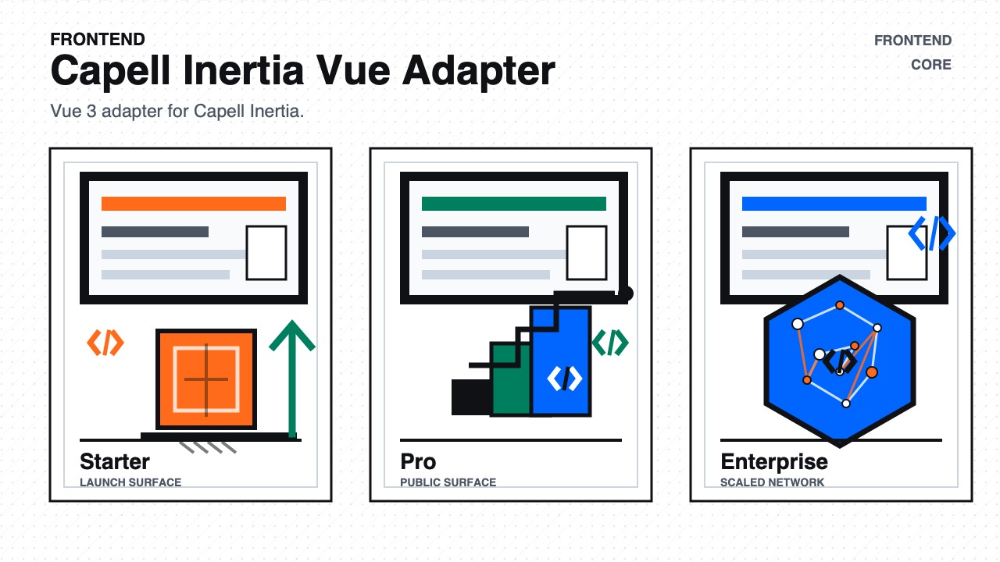

# Capell Inertia Vue Adapter

<!-- prettier-ignore-start -->

## What This Plugin Adds

Capell Inertia Vue Adapter is an **Available**, **No schema impact** Capell plugin in the **Capell Frontend** product group. It ships as `capell-app/inertia-vue-adapter` and extends these surfaces: frontend.

The Vue adapter registers a Vue client runtime with the shared Capell Inertia bridge.

It adds no admin screen. Vue-based Inertia themes can use the registered entrypoint and client runtime when they render public pages.

Evidence: [`src/Providers/InertiaVueAdapterServiceProvider.php`](src/Providers/InertiaVueAdapterServiceProvider.php), [`tests/Feature/InertiaVueAdapterServiceProviderTest.php`](tests/Feature/InertiaVueAdapterServiceProviderTest.php), [`capell.json`](capell.json), [`docs/overview.admin.md`](docs/overview.admin.md).

Status details:

- Status: Available
- Tier: core
- Bundle: frontend
- Composer package: `capell-app/inertia-vue-adapter`
- Namespace: `Capell\InertiaVueAdapter`
- Theme key: not applicable

## Why It Matters

**For developers:** The provider supplies the adapter definition and assets expected by Capell Inertia, so themes do not need their own bridge wiring.

**For teams:** Teams can choose a Vue Inertia theme without changing how editors manage Capell content.

Evidence: [`src/Providers/InertiaVueAdapterServiceProvider.php`](src/Providers/InertiaVueAdapterServiceProvider.php), [`tests/Feature/InertiaVueAdapterServiceProviderTest.php`](tests/Feature/InertiaVueAdapterServiceProviderTest.php), [`docs/overview.admin.md`](docs/overview.admin.md), [`capell.json`](capell.json).

## Screens And Workflow

Marketplace media is declared in `capell.json`:

- Beta artwork for the Vue runtime adapter; rendered proof belongs to a consuming Vue page or theme.

## Technical Shape

- Service providers: `Capell\InertiaVueAdapter\Providers\InertiaVueAdapterServiceProvider`.
- Health checks: `Capell\InertiaVueAdapter\Health\InertiaVueAdapterHealthCheck`.
- Cache tags: `inertia-vue`.

## Data Model

This package has no schema impact. It registers runtime behaviour through `Capell\InertiaVueAdapter\Providers\InertiaVueAdapterServiceProvider` while persistence remains with Capell core or required packages.

## Install Impact

- Required packages: `capell-app/core`, `capell-app/inertia`.
- Admin navigation: no admin page or resource contribution is declared.
- Admin/editor extensions: none declared.
- Permissions: none declared in `capell.json`.
- Public routes: none declared.
- Database changes: no package migrations declared.
- Config: no package config files.
- Settings: no package settings declared.
- Queues or schedules: none declared.
- Cache tags: `inertia-vue`.
- Commands: none declared.

## Common Pitfalls

- Keep required Capell packages on compatible v4 releases: `capell-app/core`, `capell-app/inertia`.
- Keep public Blade and cached HTML free of authoring markers, model IDs, permissions, signed editor URLs, and lazy database queries.
- Custom write integrations must preserve invalidation for `inertia-vue` cache tags.

## Troubleshooting

| Symptom | Likely cause | Check | Fix |
| --- | --- | --- | --- |
| Package surface is missing after install | Provider or manifest is not loaded | Confirm `capell.json`, package `composer.json`, and provider registration | Reinstall the package, refresh Composer autoload, and clear host caches |
| Public output leaks unexpected state | Render data, cache variation, or authoring boundary has regressed | Check public Blade, cache tags, and public-output safety tests | Move data loading out of Blade and rerun the package public-output tests |

## Quick Start

1. Install the package: `composer require capell-app/inertia-vue-adapter`.
2. No package-specific setup command or migrations are declared.
3. Verify the package provider and manifest contributions are registered in the host app.

## Next Steps

- [Package docs](docs/README.md)
- [Overview](docs/overview.md)
- [Troubleshooting](#troubleshooting)
- [Screenshot contract](docs/screenshots.json)
- [Marketplace assets](docs/assets/marketplace/)
- [Capell content language plan](../../docs/CONTENT_LANGUAGE_PLAN.md)
- [Capell documentation design system](../../docs/DESIGN_SYSTEM.md)
- [Capell and package ERD notes](../../docs/erd/capell-and-package-erds.md)
- Related packages: [Inertia](../inertia/README.md).
- Focused tests: `vendor/bin/pest packages/inertia-vue-adapter/tests --configuration=phpunit.xml`.

<!-- prettier-ignore-end -->
