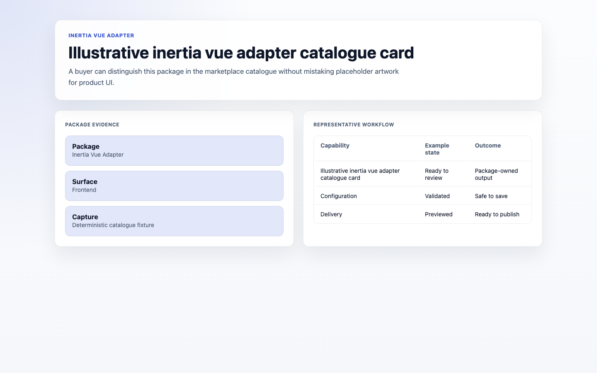

# Capell Inertia Vue Adapter

<!-- prettier-ignore-start -->

Your Vue developers get Capell pages as Vue 3 components, so they build on what Capell sends instead of writing a page client from scratch. Vue is the adapter Capell Inertia uses until told otherwise. Choosing it needs no setting, only installing it.

The build needs Vue 3.5, Inertia's Vue library and Vite's Vue integration, and the adapter declares all three for you. Page and widget HTML is cleaned on the server before Vue draws it. The components carry class names such as capell-inertia-page but no styles, so your stylesheet decides the look.

Three widget types have components of their own, which are content, image and title. Any other type is drawn by the content component, and that shows only its title and content. A page shows its title, its content and every layout container, with each widget drawn by its component.

- **Price and availability:** Check current availability and price on the [Capell Marketplace listing](https://capell.app/marketplace/extensions/inertia-vue-adapter).
- **Licence:** Check the licence terms on the [Capell Marketplace listing](https://capell.app/marketplace/extensions/inertia-vue-adapter).
- **Requires:** `PHP ^8.4`, `capell-app/core ^1.0.79`, `capell-app/frontend ^1.0.79`, `capell-app/inertia ^1.0`, `spatie/laravel-package-tools ^1.14.1`.
- **Install:** `composer require capell-app/inertia-vue-adapter:@beta`.

## Quick Start

1. Install the package: `composer require capell-app/inertia-vue-adapter:@beta`.
2. Verify the package provider and manifest contributions are registered in the host app.

## For Developers

The provider supplies the adapter definition and assets expected by Capell Inertia, so themes do not need their own bridge wiring.

## Configure

This extension works without configuration. There is nothing to set after install.

## Limits And Pitfalls

- Install the required Capell packages at the versions in `composer.json`: `capell-app/core ^1.0.79`, `capell-app/frontend ^1.0.79`, `capell-app/inertia ^1.0`.
- Keep public Blade and cached HTML free of authoring markers, model IDs, permissions, signed editor URLs, and lazy database queries.
- Custom write integrations must preserve invalidation for `inertia-vue` cache tags.

## Screens And Workflow

- Illustrative inertia vue adapter catalogue card (frontend).

## Install Impact

- Required packages: `capell-app/core`, `capell-app/frontend`, `capell-app/inertia`.
- Admin navigation: no admin page or resource contribution is declared.
- Admin/editor extensions: none declared.
- Permissions: no package permission declarations or Shield gates detected; host access rules still apply.
- Public routes: none declared.
- Database changes: no package migrations declared.
- Config: no package config files.
- Settings: no package settings declared.
- Queues or schedules: none declared.
- Cache tags: `inertia-vue`.
- Commands: none declared.

## Troubleshooting

| Symptom | Likely cause | Check | Fix |
| --- | --- | --- | --- |
| Package surface is missing after install | Provider or manifest is not loaded | Confirm `capell.json`, package `composer.json`, and provider registration | Reinstall the package, refresh Composer autoload, and clear host caches |
| Public output leaks unexpected state | Render data, cache variation, or authoring boundary has regressed | Check public Blade, cache tags, and public-output safety tests | Move data loading out of Blade and rerun the package public-output tests |

## Upgrading

No manual steps between minor versions.

## Next Steps

- [Package docs](docs/README.md)
- [Overview](docs/overview.md)
- [Troubleshooting](#troubleshooting)
- [Developer reference](docs/reference.md)
- [Marketplace assets](docs/assets/marketplace/)
- [Capell content language plan](../../docs/CONTENT_LANGUAGE_PLAN.md)
- [Capell documentation design system](../../docs/DESIGN_SYSTEM.md)
- [Capell and package ERD notes](../../docs/erd/capell-and-package-erds.md)
- Related packages: [Capell Inertia](../inertia/README.md).

<!-- prettier-ignore-end -->
